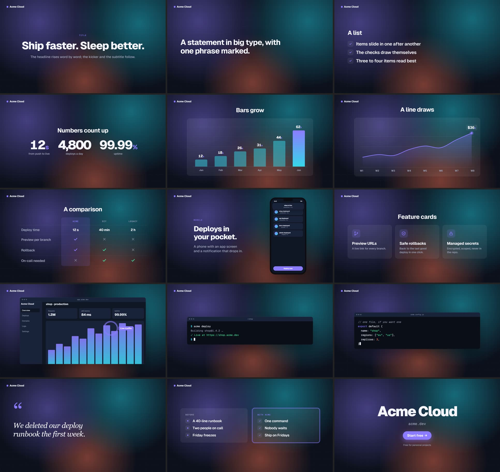
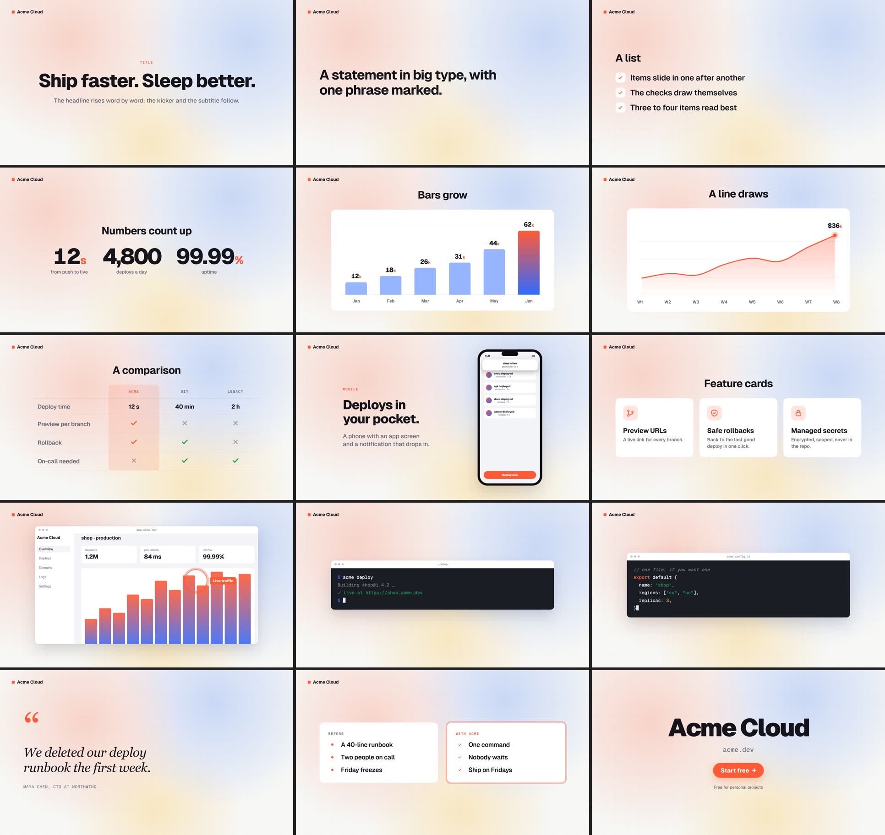
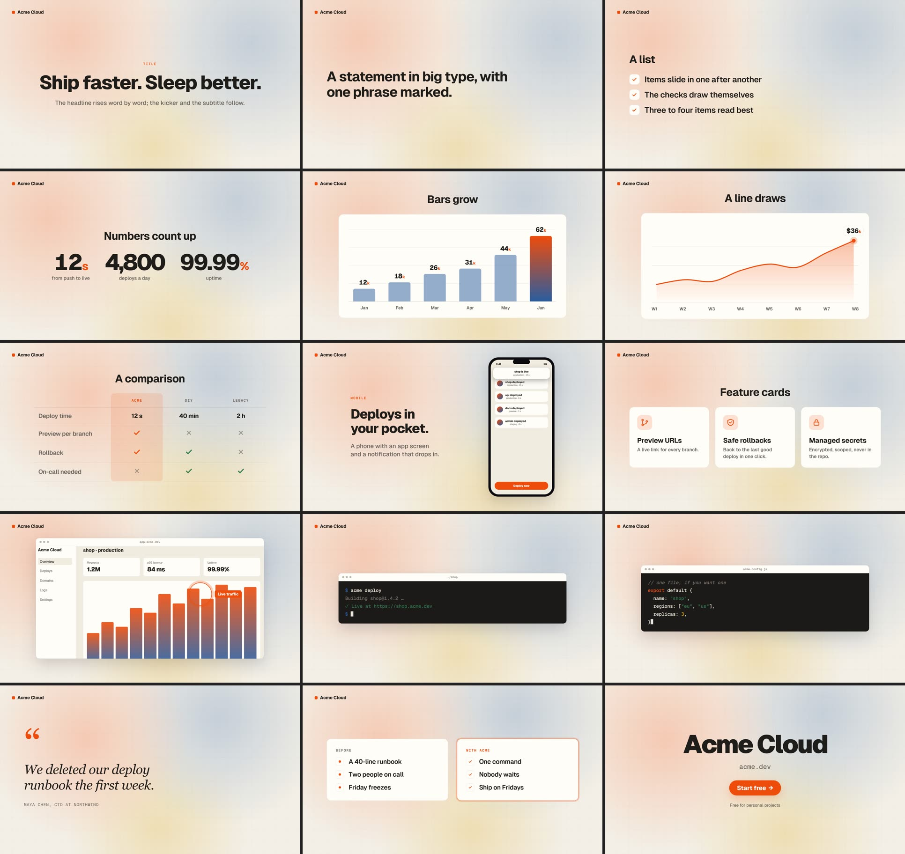
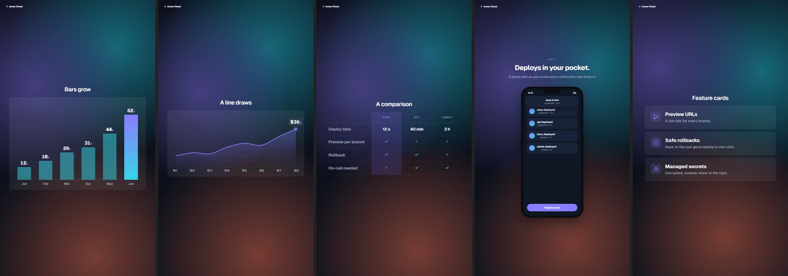

# The scenes template: a film from a list of scenes

`motigen init scenes <dir>` makes a film out of scenes: each one is one idea on screen for a few seconds, cut to
the next with a transition, on a themed stage whose glow drifts slowly. This is the template for launch videos,
feature announcements and explainers: no drawing, no timeline arithmetic, just the list.

```js
export default {
  theme: 'dark',                               // 'dark' | 'light' | 'paper'; colours in theme.css
  fps: 30,
  brand: { text: 'Acme Cloud' },               // or { logo: 'assets/logo.svg', text: '…' }; top-left, except on the end card
  background: { motion: true },                // false: a perfectly still background
  transition: { dur: 0.6, name: 'auto' },      // 'auto' varies them; or one name for all
  sfx: { transition: 'whoosh' },               // synthesised unless audio/sfx/whoosh.wav exists; null for none
  scenes: [ … ],
};
```

Every scene has `type`, `dur` (seconds), optional `vo: 'L03'` or `['L03', offset]` (the voice line from
`audio/lines.txt` starts `offset` seconds after the scene, default 0.3), optional `transition` (the way *into*
this scene) and `align: 'left' | 'center'`.

| type | fields | what happens |
|---|---|---|
| `title` | `kicker?`, `title`, `sub?`, `by: 'words' \| 'chars'` | the headline rises word by word out of a mask, the subtitle follows |
| `text` | `text`, `highlight?` | a statement in big type; the highlighted phrase gets a marker sweep |
| `list` | `title?`, `items[]`, `icon: 'check' \| 'dot' \| 'number'` | items slide in one after another; checks draw themselves |
| `stat` | `title?`, `stats: [{ value, from?, prefix?, suffix?, decimals?, label }]` | big numbers count up |
| `image` | `src` or `mock: 'dashboard'`, `frame: 'browser' \| 'none'`, `url?`, `zoom: { from, to, x, y }`, `callout: { x, y, label, at }` | a screenshot in a browser frame with a slow push-in and a callout ring |
| `terminal` | `title?`, `prompt?`, `cps?`, `lines: [{ cmd } \| { out, ok?, dim?, delay? }]` | commands typed with a human rhythm, output appears; keys and Enter go into the mix |
| `code` | `title?`, `lines[]`, `cps?` | a code block typed line by line, keywords, strings and numbers coloured |
| `quote` | `text`, `author?` | serif italic, word by word |
| `split` | `left: { title, items }`, `right: { title, items }` | before / after panels; the right one is the accented answer |
| `chart` | `title?`, `kind: 'bars' \| 'line'`, `data: [{ label, value }]`, `highlight?` (bar index, default the last), `prefix?`, `suffix?`, `decimals?`, `max?`, `min?` | bars grow with counting values and the highlighted one in the accent gradient; or a smoothed line draws left to right with a head that carries the running value |
| `table` | `title?`, `columns: ['Acme', 'DIY']`, `rows: [{ label, values: [true \| false \| 'text'] }]`, `highlight` (column index, default 0) | a comparison: rows rise one after another, ticks draw themselves, the highlighted column sits on an accent band |
| `phone` | `kicker?`, `title`, `sub?`, `side: 'left'?`, `src?` or `app?` + `items?: [{ title, sub }]` + `cta?`, `notification: { title, body, at }` | a phone with an app screen (your screenshot as `src`, or a built-in mock), the headline beside it (above it in 9:16), a notification that drops in |
| `grid` | `title?`, `items: [{ icon, title, text }]`, `columns?` | feature cards that pop in one by one; icons: `bolt` `shield` `branch` `clock` `lock` `chart` `globe` `code` `check` `spark` (cycled when not given). Three cards fit a 16:9 frame; four fit as `columns: 2`; in 9:16 they stack |
| `end` | `wordmark?` or `logo?`, `url?`, `cta?`, `note?` | the end card: name, address, a call to action |

Transitions: `cut`, `fade`, `slide-left`, `slide-up`, `wipe`, `wipe-up`, `zoom`, `blur`.

## Making it interesting

- **One idea per scene, 3–5 seconds.** Longer holds are where attention dies; if a scene needs more, split it.
- **Never two scenes of the same type in a row.** Headline → statement → terminal → numbers → product →
  list → quote → end is a rhythm; five lists in a row is a slideshow.
- **Show the product doing the thing.** A `terminal` or `code` scene with the real command, an `image` scene
  with a real screenshot (`src: 'assets/app.png'`) and a callout on the detail that matters.
- **Numbers count, text claims.** Put the one metric that matters in a `stat` scene by itself.
- **Write the voice first.** The lines set the pace; a scene lasts about as long as its line plus a beat.
- **Let the transitions vary.** `auto` already does; set one by hand only where the cut should mean something
  (a `cut` into the product, a `blur` into a quote).
- **Both formats from the same list.** `motigen build` renders 16:9 and 9:16; the layout adapts, you only check
  the frames (`motigen frames --fmt v`).

## Your own screens

Put screenshots in `assets/` and reference them from `image` scenes (or as `src` of a `phone`). Record them with
the browser recorder (`Browser.open` + `clip`) when you want the real thing at the exact state; a frame of such a
clip is a PNG you can crop. A push-in crops the edges (about 3 % per side at the default 1.06): keep what matters
away from them, or set `zoom: { to: 1 }` to hold still.

## The three themes

`theme: 'dark'` (navy, violet and cyan light), `'light'` (warm white, coral and ink), `'paper'` (cream, ink and
orange). Preview any of them without touching the film: `motigen frames --query "fmt=h&theme=paper" -t 5,20` or
`?theme=paper` on the page url in `motigen preview`. Colours are variables (`--accent`, `--accent2`, `--bg`, …)
that `theme.css` in the project can override.





In 9:16 the same list is laid out for a tall frame (the headline above the phone, cards stacked, charts taller):



Every scene type once, with its main options, is `examples/scenes-gallery/film.js`: the film these images come
from, and the place to copy from.

## Checks that come with it

- **A scene must finish before it ends.** When the page loads, the player dry-runs every scene and warns (in the
  render log, and in `window.__film.warnings`) when one is still moving less than 0.3 s before its end, with the
  duration it needs: a terminal that never finishes typing, a counter cut off mid-count. An `image` scene is
  exempt: its push-in runs to the last frame by design.
- **Frames are a pure function of t.** `motigen stability --replay -t 5,20,40` renders each moment again, last to
  first, and fails when any comes out different. A page that does that is not safe to render: the usual causes are
  `will-change` (it makes the browser keep many composited layers, and a screenshot of a fresh layer can lag),
  CSS animations and transitions, and state kept between frames. The scenes player has none of them.
- `npm test` renders the gallery in all three themes and both formats and fails when anything sticks out of the
  stage or is clipped, so a change to the styles cannot quietly break a scene type.
